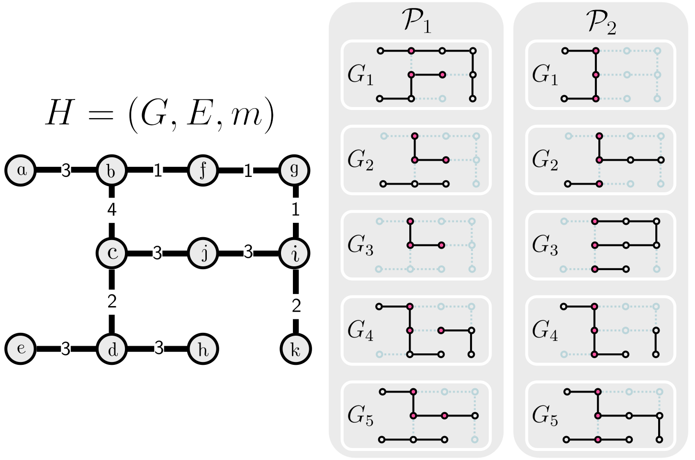
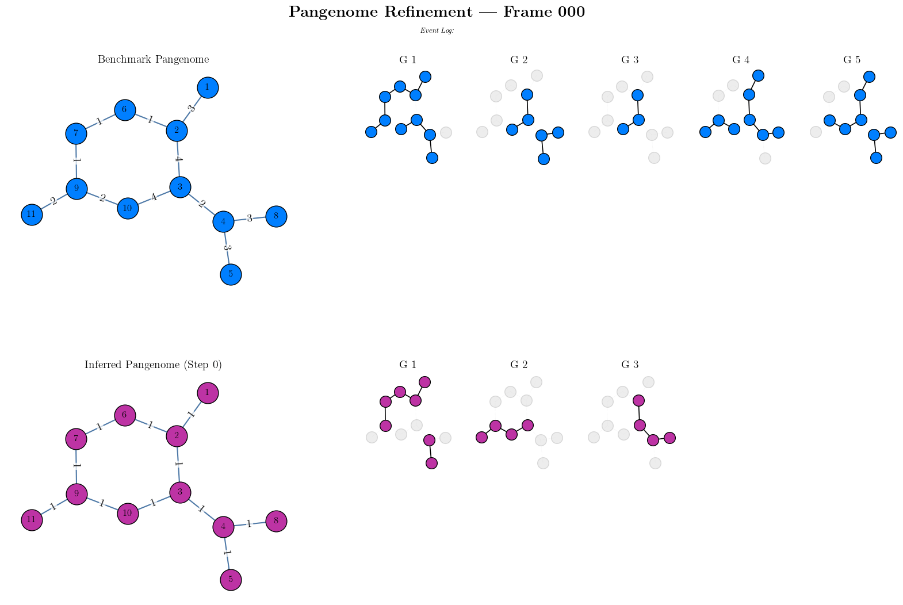
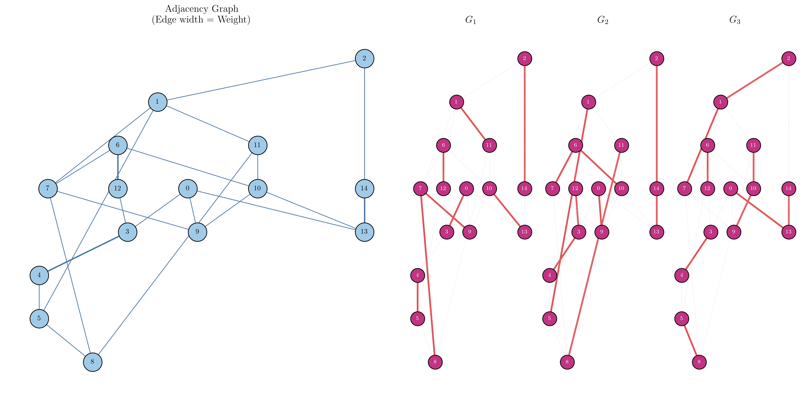

[](https://www.python.org/downloads/) [](https://github.com/astral-sh/uv) [](https://github.com/psf/black) [](https://opensource.org/licenses/MIT)

# Pangesim

### Reconstructing genome sets from adjacency information using combinatorial optimization

------

## Overview

Pangenomes are commonly represented as sets of genomes sharing a subset of genes and genomic adjacencies.

In many situations, however, only  adjacency information (sequencing reads, synteny blocks) is available:

- Which gene adjacencies exist?
- How frequently does each adjacency appear?
- Which genes are conserved across all genomes?

Recovering the original set of genomes from this compressed representation is not straightforward.

This project investigates the reconstruction of pangenomes and its constituent genomes from adjacency data alone.

The repository contains:

- Synthetic benchmark generation
- Reconstruction Algorithms
- Evaluation metrics


---

## The Combinatorial Challenge 

A pangenome can be viewed as a collection of genome paths traversing an adjacency graph. Because distinct genome combinations can induce identical edge frequency distributions, reconstruction is inherently non-unique:

The figure below illustrates the challenge:



Our input (on the left) is a graph that represents the known adjacencies between the genes. The weight of its edges represents the number of times that this adjacency was reported on the data. Our goal is to find a  Pangenome $$\mathcal{P}$$ that could explain this data. However, there could exist more than one explanation, as we can see on the right: there are two pangenomes that could explain the graph on the left.

------


## Core Components 

## Core Components

### 1. 🧬 Pangenome Evolution Simulator (`panevolve`)
Generates synthetic benchmark datasets across controlled evolutionary levels (low, medium, and high) starting from an ancestral linear genome of $n$ unique markers.
- **Evolutionary Modeling:** Simulates $k-1$ descendant genomes via independent event rates sampled from Poisson distributions ($\mathrm{Poisson}(r_e \cdot b)$).
- **Structural & Content Modifications:** Supports gene insertions, deletions, adjacency modifications, inversions, fissions, fusions, and translocations while preserving linear genome architectures.
- **Ground-Truth Tracking:** Maintains explicit lineage histories, core genome sets, and pathway matrices for rigorous benchmarking.

### 2. 🧩 Reconstruction & Refinement Pipeline (`reconstruction`)
Recovers individual genome pathways from aggregated adjacency frequencies using advanced decomposition strategies:
- **Sequential Edge Addition (SEQ):** Builds and expands genome paths incrementally based on adjacency weights.
- **Maximum Spanning Tree (MST) Path Decompositions:** Leverages tree-based decompositions for robust structural recovery, demonstrating superior performance on benchmark evaluations.
- **Iterative Refinement:** Optimizes edge residuals and path connectivity using a greedy routines (`SequentialEdgeRefinement`).

### 3. 📊 Visual Tracking & Evaluation Engine (`visualization`)
Provides comprehensive comparative analytics and visualization tooling:
- **UniMoG input generation**: Using `export_to_unimog` users can compare the DCJ-indel distance using the [UniMoG](https://wwww.cebitec.uni-bielefeld.de/bibiserv.cebitec.uni-bielefeld.de/dcj@id=dcj_manual.html) package.
- **`SmartRefinementVisualizer`:** A delta-aware dashboard comparing **Ground Truth (`#007FFF`)** against **Inferred Pangenomes (`#BD33A4`)** across stacked subgrids with explicit numeric edge weights and action logs.
- **Comparative Metrics:** Evaluates inferred collections against pangenome size, core set recovery, and structural similarity measured via the DCJ-indel distance (including specialized MwmComparisonVisualizer pipelines).
(`visualization`) Features `SmartRefinementVisualizer`, a delta-aware dashboard comparing **Ground Truth (`#007FFF`)** against **Inferred Pangenomes (`#BD33A4`)** across stacked genome subgrids, complete with explicit numeric edge weights and action logs. 



## Repository Structure

```text
.
├── src/pangesim/
│   ├── datastructures/#Pangenome models
│   ├── io/#UniMoG compatibility imports/exports
│   ├── metrics/ #Evaluation functions
│   ├── panevolve/ #main simulator
│   ├── reconstruction/ #algorithms and refinement methods
│   ├── reconstruction/ #algorithms and refinement methods
│   ├── reconstruction/ #algorithms and refinement methods
│   └── visualization/ #Plot rederings
|
├── benchmarks/ # Pangenome Reconstruction Experiments
|
├── scripts/ # Pangenome generation Unitary Experiments
│
├── workflows/
│   ├── scripts/ #Main RECOMB paper data pipeline
│       ├── generate_sim.py #Simulation parameter runner
│       ├── run_inference.py #Main inference pipeline
│       ├── post_unimog_plotter.py # MWM plots
│       └── generate_plots.py # Constituent genomes and core comparisons
|
├── results/ # wrokflow data and plots, sorted by date
├── docs/
│   ├── images/ #Dashboards and architecture diagrams
│   ├── CHANGELOG.md
│   └── contributing.md
│
├── tests/ # Unit tests
│
└── README.md
```

------

## Quick start guide

This project uses `pygraphviz` and `LaTeX` for high-fidelity pangenome network visualizations. Because these depend on system-level binaries, you must install them on your machine before setting up the Python environment.

### 1. Install System Dependencies
#### 🍏 macOS (via Homebrew)
```bash
brew install graphviz mactex-no-gui
```
#### 🐧 Ubuntu/Linux
```bash
sudo apt-get update
sudo apt-get install graphviz graphviz-dev texlive-full
```

### 2. Initialize Python Environment
Once system binaries are installed, let `uv` handle the rest:
```bash
uv sync --all-groups
```


We provide a built-in smoke test script to quickly verify your installation, run a toy pangenome evolution simulation, and output a structural grid visualization.

### Running the sample simulation 

You can execute the example script directly using `uv`:

```bash
uv run python ./scripts/run_example.py 
```

The resulting output should look like this:



------

## Research Questions

This repository explores questions such as:

- How much information is lost when only adjacency data is available?
- Which adjacency graph properties make reconstruction difficult or non-unique?
- How accurately can endogenous edge frequencies be recovered?
- How does evolutionary complexity affect reconstruction quality?

------

## Project Status

- **RECOMB 2027 Submission & Manuscript:** Formal description and benchmarking results submitted to RECOMB; preprint preparation in progress for arXiv.
- **Pangenome Simulation (`panevolve`):** Fully implemented with comprehensive evolutionary event modeling across configurable divergence tiers.
- **Reconstruction Pipelines (`reconstruction`):** Active implementations of Sequential Edge Addition (SEQ) and Maximum Spanning Tree (MST) path decomposition strategies.
- **Evaluation & Visualization:** Fully functional benchmarking suite utilizing DCJ-indel distances, core set recovery, and MWM-based comparative visualizers.


## Contributing

Please see [CONTRIBUTING.md](CONTRIBUTING.md) for
development setup and coding standards guidelines.
